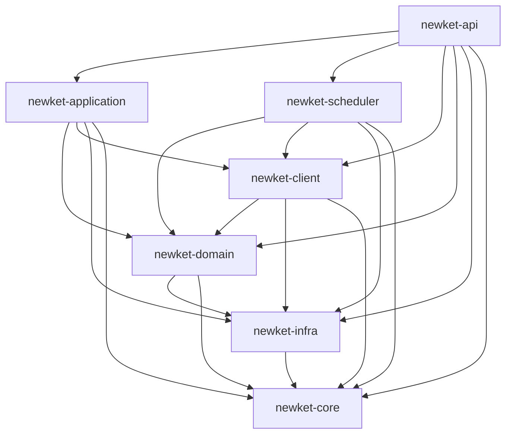

# Newket Server

뉴켓은 콘서트, 페스티벌, 뮤지컬 등 원하는 아티스트의 공연 티켓팅 일정을 알려주는 서비스입니다. 관심 아티스트의 새 공연 소식을 알림으로 받을 수 있고, 티켓 오픈 하루 전과 한 시간 전 알림을 보냅니다.

서비스를 직접 기획하고 디자이너, 기획자와 3인 팀을 구성해 개발했습니다. 프론트엔드부터 백엔드, 배포까지 서비스 전체 개발 생애주기를 맡았습니다.

이 레포지토리는 뉴켓의 백엔드입니다. Kotlin과 Spring Boot로 작성된 멀티모듈 서버이며, 앱 API, 관리자 API, 공연 정보 수집, 푸시 알림을 담당합니다. 

## 앱 다운로드

- [Google Play](https://play.google.com/store/apps/details?id=com.newket.soyaa)
- [App Store](https://apps.apple.com/kr/app/%EB%89%B4%EC%BC%93-newket-%ED%8B%B0%EC%BC%93%ED%8C%85-%EC%95%8C%EB%A6%BC/id6738327768)

## 기술 스택

| 구분           | 사용 기술                                       |
|--------------|---------------------------------------------|
| Language     | Kotlin 1.9, Java 17                         |
| Framework    | Spring Boot 3.2, Spring Security, Spring Data JPA, Spring Data MongoDB |
| Build        | Gradle 8.8 (Kotlin DSL)                     |
| Database     | MySQL, MongoDB                              |
| Auth         | JWT (Access / Refresh), 카카오·애플·구글·네이버 소셜 로그인, 관리자 세션 |
| Notification | Firebase Cloud Messaging                    |
| Storage      | Amazon S3                                   |
| Crwaling     | Playwright, Jsoup                           |
| Open API     | Slack, Gemini |

## 멀티모듈 구조

실행 가능한 애플리케이션은 `newket-api` 하나이고, 나머지 모듈은 라이브러리 jar로 빌드됩니다. `NewketApplication`이 모든 모듈의 패키지를 컴포넌트 스캔합니다.

| 모듈 이름 | 계층 / 역할                                                                 | 주요 내용 및 특징                                                                                                  |
| :--- |:------------------------------------------------------------------------|:------------------------------------------------------------------------------------------------------------|
| **`newket-api`** | **HTTP 진입점**  `Controller`, `Boot Application`                       | • `/api` 컨트롤러를 통해 앱 및 관리자 API의 진입점 제공 • 오직 이 모듈만 `BootJar`로 활성화                                          |
| **`newket-application`** | **유스케이스 계층**  `Service`                                              | • 인증, 티켓, 아티스트, 알림, 사용자, 어드민 등의 유스케이스 서비스 조합                                                             |
| **`newket-domain`** | **도메인 모델 & 비즈니스 로직**  `Reader` / `Appender` / `Modifier` / `Remover` | • 티켓, 아티스트, 사용자, 알림 설정 등의 CRUD 책임 분리 • 조회(`Reader`), 생성(`Appender`), 수정(`Modifier`), 삭제(`Remover`) 책임 분리 |
| **`newket-infra`** | **영속성 계층**  `MySQL (JPA)`, `MongoDB`                                 | • MySQL 엔티티 및 JPA 리포지토리, MongoDB 도큐먼트 및 리포지토리 구현 • 도메인 모듈이 본 구현체를 직접 참조 및 사용                             |
| **`newket-client`** | **외부 시스템 연동**  `External Integration`                                | • FCM, 카카오·애플 OAuth, AWS S3, Slack, 웹 크롤링, Google Gemini API 호출 담당                                          |
| **`newket-scheduler`** | **배치 및 스케줄러**  `Cache Sync`, `Notification`                          | • MongoDB 버퍼를 캐시에 반영 및 정합성 관리 (필요 시 캐시 삭제) • 신규 공연 소식 및 티켓 오픈 알림 자동 발송                                   |
| **`newket-core`** | **공통 및 인프라 설정**  `Security`, `Common Config`                         | • JWT 발급 및 검증, Spring Security, CORS 설정, 공통 예외 처리 전담                                                        |

의존 방향은 아래와 같습니다. 상위 모듈이 하위 모듈을 참조합니다.

## 데이터베이스

원본 데이터는 MySQL에 두고, MongoDB는 오픈 예정·예매 중인 티켓을 MySQL 내용과 동일하게 둔 캐시입니다. 

오픈예정·예매 중인 티켓 조회, 검색 등은 MongoDB에서 조회하고, 

예매 종료된 티켓, 티켓 상세페이지, 아티스트 정보, 사용자, 사용자의 알림 상태 등은 MySQL에서 조회합니다.

### MySQL

공연, 아티스트, 회원, 알림의 기준 데이터입니다.

| 영역 | 주요 엔티티 |
| --- | --- |
| 공연 | `Ticket`, `Place`, `TicketEventSchedule`, `TicketSaleUrl`, `TicketSaleSchedule`, `TicketPrice` |
| 아티스트 | `Artist`, `GroupMember`, `TicketArtist`, `TicketLineup`, `MusicalArtist` |
| 사용자 | `User`, `UserDevice`, `RefreshToken` |
| 알림 | `ArtistNotification`, `TicketNotification`, `Notification` |
| 관리자 | `AdminUser` |

공연 장르는 `CONCERT`, `FESTIVAL`, `MUSICAL`입니다. 티켓 판매처는 `nol 티켓`, `Yes24`, `멜론티켓`, `티켓링크` 등 입니다.

### MongoDB

MySQL에 나뉜 공연, 일정, 판매 일정, 아티스트를 하나의 문서로 합쳐 읽기 비용을 줄입니다.

| 컬렉션 | 역할 |
| --- | --- |
| `ticket_buffer` | 관리자가 등록한 공연의 대기 문서. 앱에는 아직 노출하지 않습니다. |
| `ticket_cache` | 앱이 조회하는 캐시. 판매 전·판매 중 목록, 검색, 아티스트별 공연에 사용합니다. |

등록 흐름은 MySQL에 원본을 저장한 뒤 `ticket_buffer`에 같은 내용을 문서화하고, 스케줄러가 매일 2시에 `ticket_buffer`를 `ticket_cache`로 옮긴 다음 관심 아티스트 알림을 보내는 순서입니다. 매일 자정에 판매가 끝난 캐시는 삭제됩니다.

## 주요 기능

### 앱 API

- 소셜 로그인과 회원가입, Access Token·Refresh Token 재발급, 탈퇴
- 장르별 오픈 예정·예매 중인 티켓 목록, 검색, 자동완성, 티켓 상세 조회, 아티스트의 그룹·그룹의 멤버 조회
- 관심 아티스트 등록과 아티스트별 공연 조회
- 티켓 오픈 알림 신청, 알림 목록 조회
- 기기 토큰 등록과 알림 수신 설정
- 등록되지 않은 아티스트, 앱 문의 요청 slack으로 전송

### 관리자 API

- 관리자 로그인
- 공연·뮤지컬 조회,등록,수정,삭제
- 아티스트·그룹·공연장 관리
- 티켓 공지 크롤링과 AI를 이용한 공연 정보 자동화 추출
- 포스터 이미지 S3 업로드

관리자의 공연 생성·수정·삭제와 아티스트·공연장 수정은 `ADMIN` 권한이 필요합니다.

### 알림

FCM으로 두 종류의 푸시를 보냅니다. 발송 이력은 MySQL `Notification`에 남깁니다.

- **새 공연**: 매일 오후 2시에 `ticket_buffer`가 `ticket_cache`로 반영될 때, 해당 아티스트를 관심 등록하고 아티스트 알림을 켠 사용자에게 발송합니다.
- **티켓 오픈**: 판매 일정 기준 하루 전과 한 시간 전에, 해당 티켓 알림을 신청하고 티켓 알림을 켠 사용자에게 발송합니다.
